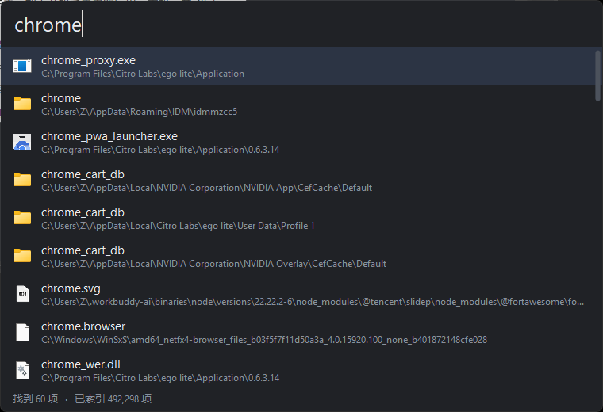

# SwiftFind

[](https://github.com/Sword00/SwiftFind/releases/latest)


**双击 Ctrl，弹出一个搜索框；输入几个字母，全盘的文件和应用都在里面；回车打开。**

没有主界面，没有启动动画，也不占托盘。平时它等于不存在，你要用它的时候按两下 Ctrl。

**[下载最新版](https://github.com/Sword00/SwiftFind/releases/latest)** —— 218 KB，Windows 10 / 11，双击即用。



## 它能做什么

- **双击 Ctrl 唤出** —— 第一次按下只出现一条搜索框，输入之后才展开结果，不挡视线
- **搜全盘** —— 所有固定磁盘的文件和文件夹，加上开始菜单里的应用，本机一共 49 万个对象
- **快到不用等** —— 边打边搜，4~10 毫秒出结果，应用和 exe 排在前面
- **带真实图标** —— 用的是系统里那个文件自己的图标，不是千篇一律的默认图
- **跟你的主题走** —— 深色、浅色、跟随系统，切换即时生效
- **只有一个文件** —— 218 KB 的 exe，拷到任何 Windows 10/11 上双击就能跑，不用装运行库

## 怎么用

| 按键 | 做什么 |
|---|---|
| 双击 `Ctrl` | 打开搜索框 |
| 打字 | 边打边搜 |
| `↑` `↓` | 上下选择 |
| `Enter` | 打开；文件夹会用资源管理器打开 |
| `Esc` | 收起 |
| 框内右键 | 设置、重建索引、退出 |
| `Ctrl` + `,` | 直接打开设置 |

把输入清空，窗口会自己收回成一条搜索框。

## 设置

搜索框里按 `Ctrl` + `,`，或者右键点「设置…」。托盘图标右键也能进——如果你没把托盘图标关掉的话。

- **开机自动启动** —— 登录后自动待命，不用每次手动开。exe 挪了位置也不用管，下次打开会自己把路径改过来
- **失焦自动隐藏** —— 点到别处就收起；关掉它就得自己按 Esc
- **跟随鼠标位置打开** —— 窗口出现在鼠标旁边，而不是屏幕正中
- **显示托盘图标** —— 不想要托盘里多个图标可以关掉
- **主题** —— 浅色 / 深色 / 跟随系统
- **重建索引** —— 新装了软件、新建了文件之后点一下

## 下载与编译

到 [Releases](https://github.com/Sword00/SwiftFind/releases/latest) 里下最新的 `SwiftFind-v*.exe`，就一个文件，双击即用，不需要安装程序。

想自己编也行——需要 MinGW-w64，最省事的是 [w64devkit](https://github.com/skeeto/w64devkit)，解压就能用：

```bash
./build.sh

# 如果 w64devkit 不在 PATH 上：
W64DEVKIT=/path/to/w64devkit ./build.sh
```

只链接 Windows 自带的 DLL，所以编出来的 exe 不依赖任何额外文件，直接发给别人也能跑。

## 一些实现上的选择

**索引只存文件名，不存完整路径。** 目录名去重后单独存一份，每条记录 12 字节，49 万个对象压到 30 MB 左右。启动时直接 mmap 读进来，所以开程序是瞬时的。

**搜索是多线程暴力扫。** 每个核心扫一段，没有倒排索引也没有分词——反正只有 49 万条，扫一遍就是几毫秒的事。

**体积上抠得很细。** 218 KB 里只有 46 KB 是自己的代码，剩下全是静态链接的 C++ 标准库。中间有几个意外发现：`std::thread` 只用了三处，却把整套 pthread 拖进来 27 KB；`swprintf` 只调了两次，却带进整个浮点格式化（7 KB）。换成 Win32 API 和手写数字转换之后，整体小了 29%。

**图标是算出来的，不是画的。** 用有向距离场逐像素生成，任意尺寸都清晰。16px 下会去掉闪电只留镜片——否则闪电缩成一个小点，镜片看起来像破了个口。

## 命令行

平时双击就行，下面这些是给调试和脚本用的：

```bash
SwiftFind.exe                # 静默启动，只在后台待命
SwiftFind.exe --show         # 启动并立刻显示搜索框
SwiftFind.exe --query node   # 启动并预填查询词
SwiftFind.exe --reindex      # 重建索引，打印统计
SwiftFind.exe --search node  # 纯命令行搜索，输出路径和耗时
SwiftFind.exe --settings     # 直接打开设置面板
```

## 已知的限制

- 索引是**快照**。新建文件后要手动点「重建索引」，或者重启程序
- 只搜**文件名**，不搜文件内容，也不匹配完整路径
- 同一个应用的多个快捷方式会分别出现，不去重
- 只索引固定磁盘，U 盘和移动硬盘不扫

---

`src/main.cpp` 是整个程序（约 1000 行）。`tools/` 里是开发时用来验证的小工具——截图、模拟按键、校验图标、枚举窗口，不影响程序本身，感兴趣可以看看。

## 许可证

[MIT](LICENSE) © 2026 Sword00
